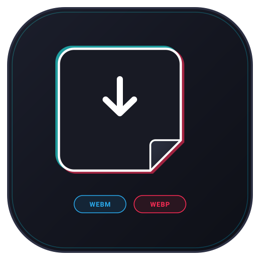

  

<h1 align="center">TikTok Sticker Downloader</h1>

  
  
  
  
  

  Module LSPosed tải sticker và ảnh động trong phần bình luận TikTok, hỗ trợ lưu file gốc hoặc chuyển đổi sang WebM VP9 để làm video sticker trên Telegram.

---

## Tính năng

- **Nhấn giữ để tải:** Nhấn giữ vào bất kỳ sticker nào trong mục bình luận để mở menu thao tác (không làm gián đoạn cử chỉ vuốt).
- **Lưu file gốc:** Tự động nhận diện định dạng từ CDN (WebP động, WebP tĩnh, PNG, JPG, GIF) và lưu vào `Pictures/TikTokStickers/`.
- **Chuyển đổi WebM VP9:** Tự render từng khung hình WebP sang video WebM theo đúng chuẩn Video Sticker của Telegram (tối đa 512px, 30 FPS, thời lượng dưới 3s).
- **Gửi nhanh sang Telegram:** Mở trực tiếp Telegram/Nekogram kèm file WebM để gửi cho các bot tạo sticker (như `@VideoStickerzBot`).
- **Giao diện đồng bộ:** Thiết kế dạng BottomSheet tối màu theo phong cách của TikTok, sử dụng vector icon phẳng.

## Hỗ trợ

- Đã test trên các bản TikTok:
  - `com.ss.android.ugc.trill` (TikTok Việt Nam / Châu Á)
  - `com.zhiliaoapp.musically` (TikTok Global)
- Yêu cầu thiết bị đã cài LSPosed (Zygisk).

## Hướng dẫn sử dụng

1. Tải APK từ mục [Releases](../../releases) hoặc tab [Actions](../../actions) rồi cài vào máy.
2. Bật module trong LSPosed, tích chọn ứng dụng TikTok trong danh sách scope.
3. Buộc dừng TikTok rồi mở lại.
4. Mở một video bất kỳ, vào phần bình luận có sticker và nhấn giữ vào sticker để chọn thao tác.
